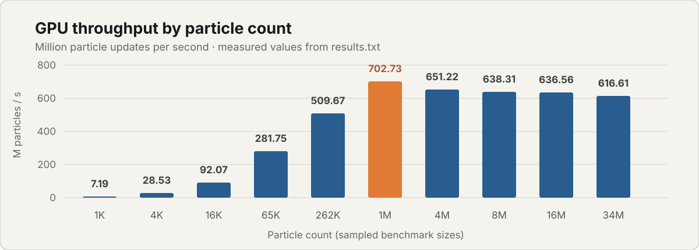
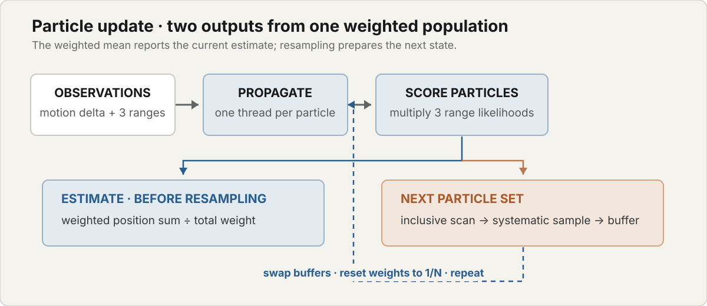
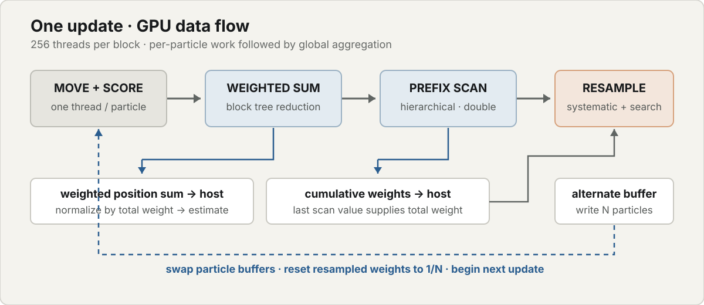

# Monte Carlo Localization (MCL) with CUDA

## Overview

This project estimates a moving point's 2D position from noisy distance readings to three fixed beacons. A CUDA particle filter propagates candidate positions, scores them against each observation, computes a weighted estimate, and resamples the population for the next update.

The benchmark simulates a circular path centered at `(5, 4)` and exercises particle counts from 1,024 to 33,554,432. The technical sections below describe the update equations, kernel structure, memory flow, scan implementation, and benchmark methodology.

## GPU benchmark

The recorded run reaches **702.73 million particle updates per second** at 1,048,576 particles on an NVIDIA GeForce RTX 4050 Laptop GPU. Throughput then levels near 617–651 million updates per second for the largest tested populations.

<p align="center">
  
</p>

| Particles | GPU time (ms/update) | Throughput (M updates/s) | RMSE |
|---:|---:|---:|---:|
| 1,024 | 0.1424 | 7.19 | 0.0657 |
| 4,096 | 0.1436 | 28.53 | 0.0651 |
| 16,384 | 0.1779 | 92.07 | 0.0651 |
| 65,536 | 0.2326 | 281.75 | 0.0654 |
| 262,144 | 0.5143 | 509.67 | 0.0653 |
| 1,048,576 | 1.4922 | 702.73 | 0.0653 |
| 4,194,304 | 6.4407 | 651.22 | 0.0617 |
| 8,388,608 | 13.1418 | 638.31 | 0.0618 |
| 16,777,216 | 26.3561 | 636.56 | 0.0618 |
| 33,554,432 | 54.4175 | 616.61 | 0.0814 |

The GPU results were recorded on an RTX 4050 Laptop GPU with 20 SMs, 6.0 GB of memory, and compute capability 8.9. RMSE is the root mean squared Euclidean position error over timed updates. Full output, including CPU timing reference results, is in [`results.txt`](results.txt); the CPU implementation is used only for benchmarking.

## Build status

The source requires the CUDA runtime, cuRAND headers, a CUDA-capable C++ compiler, and an NVIDIA GPU. The repository does not contain a checked-in build configuration, so it currently has no reproducible build command.

## Source files

- [`main.cu`](main.cu) — simulated trajectory, benchmark setup, and result reporting.
- [`particle_filter.cuh`](particle_filter.cuh) — CUDA kernels and particle-filter orchestration.
- [`results.txt`](results.txt) — recorded benchmark output.

## Technical details

### State and measurement model

The target's benchmark trajectory is a circle with center `(5, 4)`, radius `3`, and angular increment `0.05` radians per update. Its position at step `t` is:

```math
\begin{aligned}
\mathrm{truth}(t) &= \left(5 + 3\cos(0.05t),\; 4 + 3\sin(0.05t)\right) \\
\Delta(t) &= \mathrm{truth}(t) - \mathrm{truth}(t - 1)
\end{aligned}
```

The three beacons are `(0, 0)`, `(10, 0)`, and `(5, 10)`. For each beacon, the observed range is its Euclidean distance from the current truth plus Gaussian noise with standard deviation `0.2`. The benchmark seeds the sensor-noise generator with `42`.

At initialization, particle positions are sampled independently from a normal distribution centered on `truth(0)` with standard deviation `1.0`. A separate cuRAND state is initialized per particle using the filter seed and the particle index.

For particle `i`, the motion-noise standard deviation scales with the magnitude of target displacement. Two independent normal samples perturb its position:

```math
\begin{aligned}
\sigma_{\text{motion}} &= 0.01 + 0.05\,\mathrm{hypot}(\Delta_x, \Delta_y) \\
x_i' &= x_i + \Delta_x + \sigma_{\text{motion}}\,\epsilon_x \\
y_i' &= y_i + \Delta_y + \sigma_{\text{motion}}\,\epsilon_y
\end{aligned}
```

For sensor `j`, let `d_ij` be the predicted distance from moved particle `i` to beacon `j`, `r_j` the observed range, and `sigma_j` the sensor standard deviation. The code computes a Gaussian range likelihood and multiplies the three sensor values to get the particle weight:

```math
\begin{aligned}
z_{ij} &= \frac{d_{ij} - r_j}{\sigma_j} \\
L_{ij} &= \exp\left(-\frac{1}{2}z_{ij}^2\right) \\
w_i &= L_{i0}L_{i1}L_{i2}
\end{aligned}
```

The position prediction is the weighted mean of the moved population, computed before resampling:

```math
\begin{aligned}
W &= \sum_i w_i \\
\hat{x} &= \frac{\sum_i x_i' w_i}{W} \\
\hat{y} &= \frac{\sum_i y_i' w_i}{W}
\end{aligned}
```

### Update algorithm

<p align="center">
  
</p>

The scan and weighted-mean reduction both consume the freshly computed weights. The mean uses the moved particle positions. The scan produces an inclusive cumulative distribution used to select the next population. Resampled particles go into a separate buffer, so reads from the current population do not overlap writes to the next one.

### CUDA execution and data flow

Each launch uses 256 threads per block. The grid has `ceil(N / 256)` blocks, and the final block masks particle indices beyond `N`. The filter keeps these device-side arrays:

- Two `float2` particle buffers: current positions and resampling output.
- One float weight per particle and one double cumulative weight per particle.
- One cuRAND state per particle.
- A `double2` weighted-position accumulator and recursively sized scan scratch storage.

`moveAndWeighKernel` assigns one thread to each particle. It loads that particle's position and RNG state, applies the target displacement and process noise, stores the updated position and RNG state, evaluates the sensor likelihoods, and writes a fresh weight.

#### Weighted-position reduction

`weightedSumReductionKernel` forms `(x_i' * weight_i, y_i' * weight_i)` for each particle. Within each block, threads reduce those pairs through shared memory using a binary tree: strides decrease from 128 to 1, with a block barrier after each level. Out-of-range threads contribute zero. Thread zero atomically adds each block's partial result to a cleared global `double2` accumulator; the shared-memory block partials themselves are `float2`.

#### Hierarchical inclusive scan

`prefixSum` scans the float weights into double cumulative weights. For each group of up to 256 values, `prefixSumKernel` uses double shared memory and doubling offsets (`1, 2, 4, ... 128`) to produce an inclusive block scan. The last lane writes the block total. If multiple blocks were used, the routine recursively scans those totals, then `addBlockOffsetsKernel` adds each block's preceding scanned total to its local outputs. A one-block input skips the recursive and offset-add stages. `prefixSumScratchSize` reserves the scratch arrays for the full recursion depth.

#### Systematic resampling

After the scan, the host reads the final cumulative weight, `total_weight = cumulative[N - 1]`. It draws one uniform offset `u0`; for output index `k`, the resampling target is:

```math
t_k = \frac{u_0 + k}{N}\,W
```

`resampleKernel` performs a lower-bound binary search for the first cumulative weight greater than or equal to `target_k`. The output thread copies that source particle to the alternate buffer and sets its output weight to `1/N`. Once the kernel is queued, the two particle-buffer pointers are swapped for the next call to `iterate`.

#### Host and device boundary

The weighted-position reduction runs first. A device-to-host copy returns its `double2` sum, then the inclusive scan runs and a second copy returns its final double total. Those values are divided on the host to update `prediction`. The host also generates the resampling offset; the selection search and particle copies remain on the GPU. The benchmark synchronizes around each timed update, so its reported GPU time includes kernel work and these host-device transfers.

The execution path is summarized below. The reduction and scan process the same per-particle weights for different purposes: one produces the estimate, the other supplies the cumulative distribution for resampling.

<p align="center">
  
</p>
